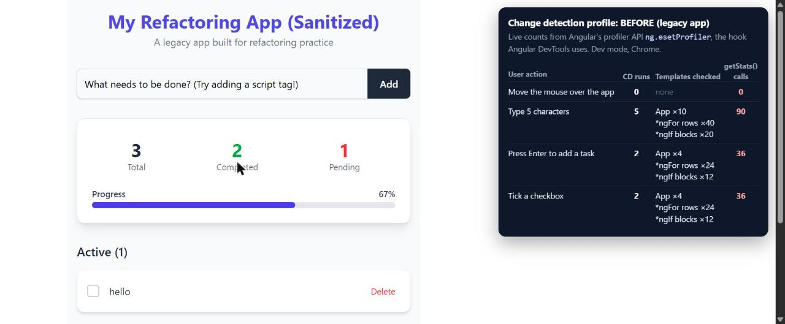
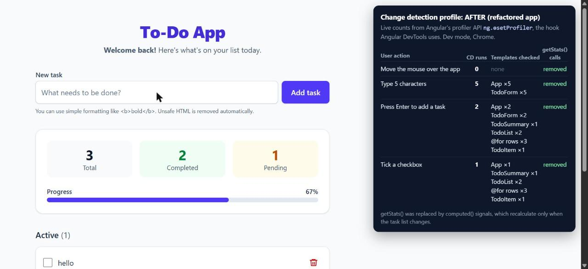

# To-Do App: Performance & Best Practices (Angular)

A small Angular to-do app, refactored from a legacy monolithic component into a fast,
maintainable and secure application using **OnPush change detection, signals, `computed()`,
the async pipe, `shareReplay` caching, `DomSanitizer` and reusable components**.

## Features

- Add, complete and delete tasks
- Live stats (total, completed, pending) and a progress bar
- Separate Active and Completed lists with empty states
- Welcome message loaded from a simulated API, with loading and error states
- Task text may contain simple HTML, which is sanitized to block XSS
- Responsive layout (phone, tablet, desktop) and keyboard / screen-reader friendly

## Tech stack

- Angular 20 (standalone components, signals, built-in control flow)
- RxJS 7
- Tailwind CSS 4
- Karma + Jasmine for unit tests
- Netlify for hosting

## Getting started

Requires Node.js 20.19+ (or 22.12+).

```bash
npm install
npm start          # http://localhost:4200
```

## Scripts

| Command | Description |
| --- | --- |
| `npm start` | Start the dev server |
| `npm run build` | Production build into `dist/` |
| `npm test` | Run unit tests (Karma, watch mode) |
| `npx ng test --watch=false` | Run unit tests once |

## Architecture

```
App (smart container: talks to services)
├── TodoForm     input + "Add task"        [(description)] → (add)
├── TodoSummary  stats tiles + progress     [stats] [progress]
├── TodoList     "Active"                   [todos] → (toggle) (remove)
│   └── TodoItem one row per task           [todo]  → (toggle) (remove)
└── TodoList     "Completed" (same component, different inputs)

TodoService     signal state, computed() derived state, immutable updates
WelcomeService  simulated API call, cached with shareReplay
SafeHtmlPipe    DomSanitizer.sanitize(SecurityContext.HTML, …)
```

- **Services hold all state and logic.** Components never change data themselves.
- **Dumb components** receive data through `input()` and report actions through `output()`.
  Every component uses `ChangeDetectionStrategy.OnPush`.
- **Signals:** `todos` is a private writable signal exposed read-only. Stats, progress and
  the two lists are `computed()` values, so they recalculate only when `todos` changes.
- **Immutable updates:** `update()` with `map` / `filter` / spread, never `push` or in-place edits.
- **Lists** use `@for (...; track todo.id)`, the built-in equivalent of `*ngFor` + `trackBy`.
- **Async pipe:** the header subscribes to `welcome$` in the template, so there is no manual
  subscribe/unsubscribe.
- **Caching:** `defer()` + `shareReplay({ bufferSize: 1, refCount: false })` makes the simulated
  request run once for any number of subscribers.
- **Security:** no `bypassSecurityTrustHtml()`. All HTML goes through `SafeHtmlPipe`, which strips
  `<script>`, event handlers and `javascript:` URLs.

## Project structure

```
src/app/
├── app.ts                         smart container component
├── core/
│   ├── models/todo.model.ts       Todo and TodoStats types
│   └── services/
│       ├── todo.service.ts        state + business logic
│       └── welcome.service.ts     simulated API with caching
├── features/todos/components/
│   ├── todo-form/                 add-task form
│   ├── todo-summary/              stats and progress bar
│   ├── todo-list/                 reusable titled list
│   └── todo-item/                 single task row
└── shared/pipes/safe-html.pipe.ts sanitizer pipe
docs/profiler/                     before / after measurements and screenshots
```

## Performance: before vs after

The same actions were recorded on the legacy app and on the refactored app, with live counts
from Angular's profiler API (`ng.ɵsetProfiler`, the hook Angular DevTools uses), in development mode.
Full details: [baseline](docs/profiler/baseline.md) and [after refactor](docs/profiler/after-refactor.md).

| Action | Before | After |
| --- | --- | --- |
| Move the mouse over the app | 0 runs | 0 runs |
| Type 5 characters | 5 runs: App ×10, 40 `*ngFor` rows, 20 `*ngIf` blocks, **90 `getStats()` calls** (900,000 loop iterations) | 5 runs: only App ×5 and TodoForm ×5, **no stats recalculated** |
| Press Enter to add a task | 2 runs, whole template, 36 `getStats()` calls | 2 runs: summary once, lists, only the new row |
| Tick a checkbox | 2 runs, whole template, 36 `getStats()` calls | 1 run: summary once, lists, only the moved row |
| Welcome API call | Once per subscriber | Once in total (`shareReplay`) |

**What improved:** the work done in each change detection run. OnPush skips every component whose
inputs and signals did not change, `computed()` returns cached values, and `@for` with `track`
reuses existing rows. Mouse movement never triggered change detection in either version, because
nothing listens for `mousemove`.

| Before | After |
| --- | --- |
|  |  |

## Accessibility

- Semantic structure: one `h1`, `main`, labelled `section`s and real `ul`/`li` lists
- Visible label on the task input; validation error announced with `role="alert"`
- Loading message uses `role="status"`; API error uses `role="alert"`
- Icon buttons have full names, e.g. "Delete task: Build a project"
- Checkboxes are labelled by their task text
- Progress bar exposed with `role="progressbar"` and `aria-valuenow`
- Visible `:focus-visible` outline on all interactive elements
- Colour contrast meets WCAG AA; animations respect `prefers-reduced-motion`

## Responsiveness

Mobile-first Tailwind layout, tested at 375px, 768px and desktop widths with no horizontal
scrolling. The input and button stack on small screens, and long task names wrap.

## Testing

31 unit tests cover:

- `TodoService`: signals, `computed()` memoisation, immutable add / toggle / delete
- `WelcomeService`: the API runs once for multiple and late subscribers
- `SafeHtmlPipe`: strips `<script>`, `onerror` and `javascript:` URLs, keeps safe tags
- Components: inputs, outputs, empty states, validation and accessible names
- `App`: loading and error states, sanitized welcome message and adding a task

```bash
npx ng test --watch=false
```

## Deployment

Deployed on Netlify using [`netlify.toml`](netlify.toml):

- Build command: `npm run build`
- Publish directory: `dist/performance-and-best-practices-angular/browser`
