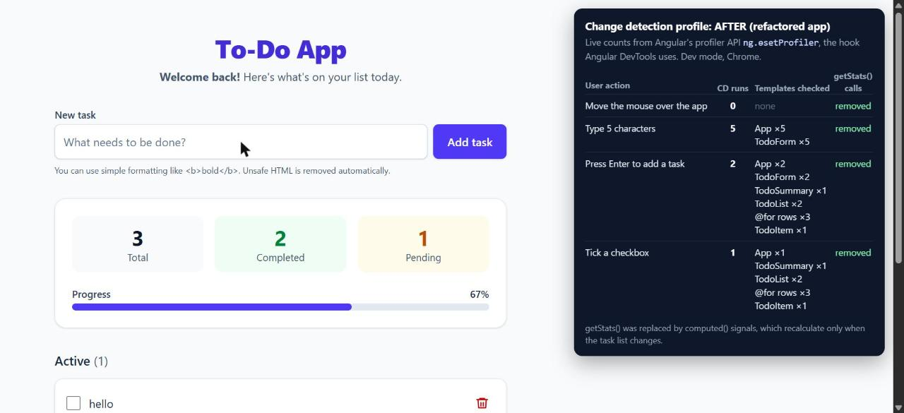

# Performance after the refactor

<!-- PERFORMANCE LAB: after measurements, same actions as baseline.md -->

Measured on the refactored app (`ng serve`, development mode, Chrome) with the same method as
the baseline: live counts from Angular's profiler API (`ng.ɵsetProfiler`, the hook Angular
DevTools uses), counting every change detection run and every template that is actually checked.

## Change detection per user action

| Action | CD runs | Templates checked |
| --- | --- | --- |
| Move the mouse over the app | 0 | none |
| Type 5 characters | 5 | App ×5, TodoForm ×5 |
| Press Enter to add a task | 2 | App ×2, TodoForm ×2, TodoSummary ×1, TodoList ×2, `@for` rows ×3, TodoItem ×1 |
| Tick a checkbox | 1 | App ×1, TodoSummary ×1, TodoList ×2, `@for` rows ×3, TodoItem ×1 |

`getStats()` no longer exists. Stats, progress and both lists are `computed()` signals, so they
are recalculated once when the task list changes and never while typing.

## Before vs after

| | Before | After |
| --- | --- | --- |
| Typing 5 characters | Whole template ×10, 60 row/block views, 90 `getStats()` calls | Only App and TodoForm, nothing recalculated |
| Ticking a checkbox | 2 runs over the whole template, 36 `getStats()` calls | 1 run; only the moved row is rendered (`TodoItem ×1`) |
| Derived state | Recomputed on every check | `computed()`: recalculated once per real change |
| List rendering | `*ngFor` without tracking | `@for` with `track todo.id`: existing rows are reused |
| API call | Re-runs for every subscriber | Runs once (`shareReplay`) |

## Reading the numbers honestly

- **Mouse movement never triggered change detection**, before or after. There are no
  `mousemove` listeners and hover effects are CSS only.
- **The number of runs while typing stays the same** (one per keystroke). zone.js still starts a
  run for every DOM event. What changed is **how much work each run does**: OnPush skips every
  component whose inputs and signals didn't change, and `computed()` returns cached values.
- A checkbox tick dropped from 2 runs to 1, and only the one moved row is re-rendered.
- Going zoneless (`provideZonelessChangeDetection()`) would also reduce the number of runs. The
  app is ready for it, since all state is signals or the async pipe.
