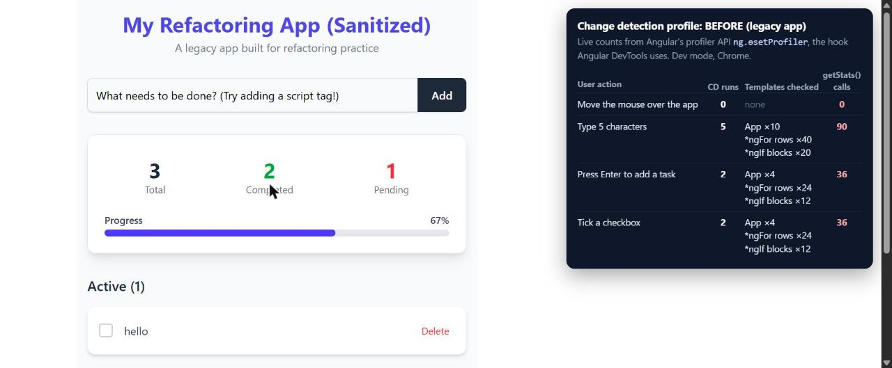

# Performance baseline (legacy app, before refactor)

<!-- PERFORMANCE LAB: baseline measurements taken before any code change -->

Measured on the unmodified legacy app (`ng serve`, development mode, Chrome) with live counts
from Angular's profiler API (`ng.ɵsetProfiler`, the hook Angular DevTools uses). `getStats()`
calls were counted by wrapping the method from the console. No source code was changed.



## Change detection per user action

| Action | CD runs | Templates checked | `getStats()` calls |
| --- | --- | --- | --- |
| Move the mouse over the app | 0 | none | 0 |
| Type 5 characters | 5 | App ×10, `*ngFor` rows ×40, `*ngIf` blocks ×20 | 90 |
| Press Enter to add a task | 2 | App ×4, `*ngFor` rows ×24, `*ngIf` blocks ×12 | 36 |
| Tick a checkbox | 2 | App ×4, `*ngFor` rows ×24, `*ngIf` blocks ×12 | 36 |

## Findings

- **Mouse movement alone triggers no change detection.** The component has no `mousemove`
  listener, and `hover:` effects are pure CSS, so zone.js has nothing to react to.
- **Every keystroke, click and Enter does.** Each one checks the whole monolithic template with
  the Default strategy, including every row of both `*ngFor` loops.
- **Each check is expensive.** The template calls `getStats()` 7 times and
  `getProgressPercentage()` twice, and the latter calls `getStats()` again: 9 calls per pass,
  each with a 10,000-iteration loop. In development mode Angular checks twice per run
  (`checkNoChanges`), so one run = 18 calls = 180,000 wasted iterations. Typing 5 characters
  cost 900,000 iterations.
- **Security:** the header uses `bypassSecurityTrustHtml()`, which disables Angular's
  sanitizer for that HTML. Task descriptions go through `[innerHTML]`, relying on Angular's
  implicit sanitizer.

## How to reproduce

```bash
git switch --detach baseline
npm start
# then record with the Angular DevTools Profiler while doing the actions above
git switch main
```
